# Compte rendu — TP Hadoop sous Ubuntu
*Clusters, HDFS, YARN, MapReduce et Python*

**Nom / binôme :** _________KARAMOKO ISSIAKA_____________  **Date :** 01/11/2026

**Environnement :** VM Ubuntu (`ubuntu-srv`), OpenJDK 11, Hadoop 3.3.6 en mode pseudo-distribué, utilisateur `etudiant` (chemins `/home/etudiant`).

---

## 1. Captures d'écran

### 1.1 Installation

Java 11 installé :

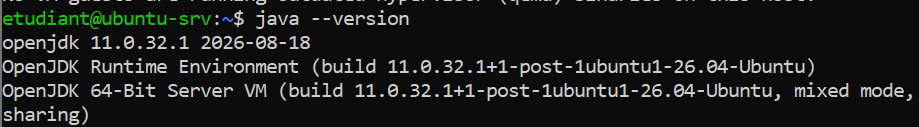

Hadoop 3.3.6 reconnu (variables d'environnement correctes) :

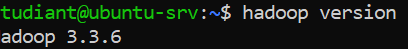

Formatage du NameNode réussi :

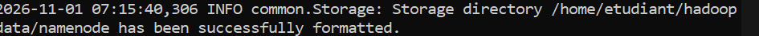

### 1.2 Sortie de `jps`

Les 5 démons Hadoop sont actifs (NameNode, DataNode, SecondaryNameNode, ResourceManager, NodeManager).

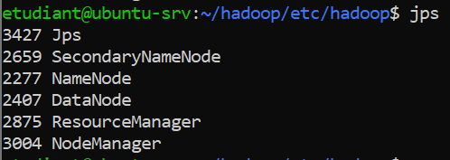

### 1.3 Interfaces web

**NameNode (9870)** : HDFS actif sur `localhost:9000`, version 3.3.6, Safemode off.

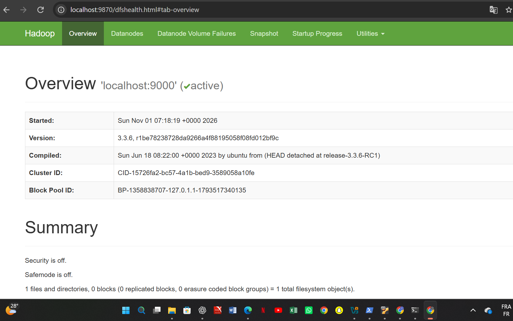

**ResourceManager (8088)** : YARN actif, 1 nœud actif.

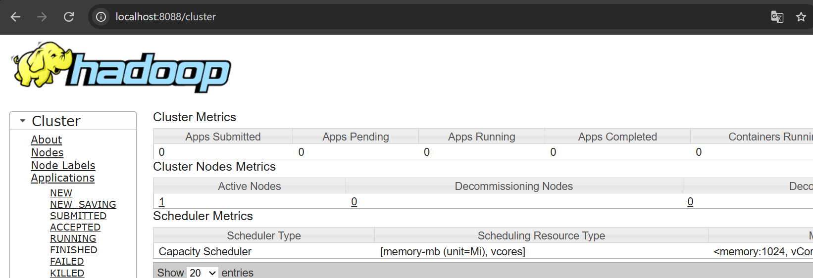

### 1.4 Résultat de chaque job

**Exercice 1 — HDFS** : `poeme.txt` (85 octets) occupe 1 bloc, statut HEALTHY.

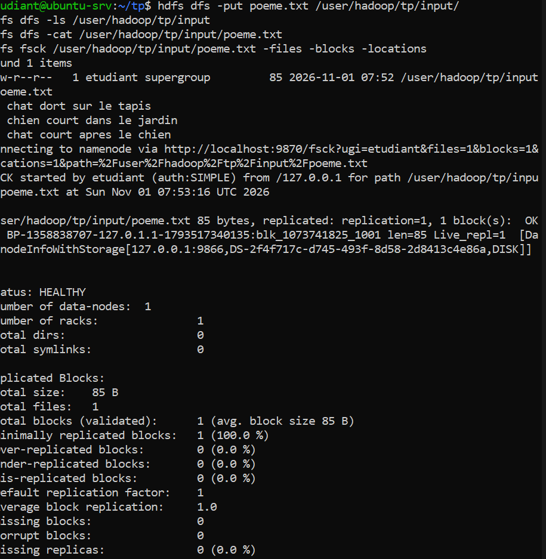

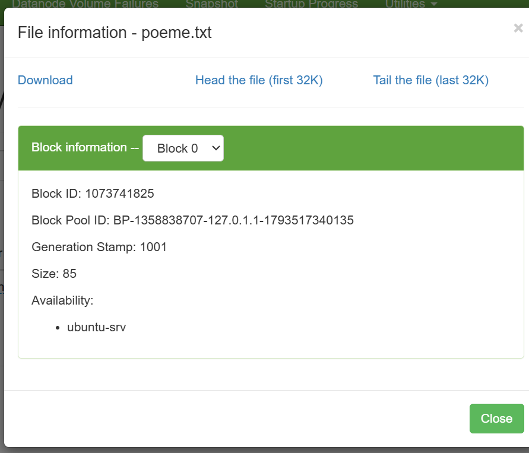

**Exercice 2 — WordCount** : test local, puis job Hadoop (`_SUCCESS` et `part-00000`) avec le même résultat.

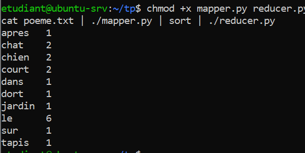

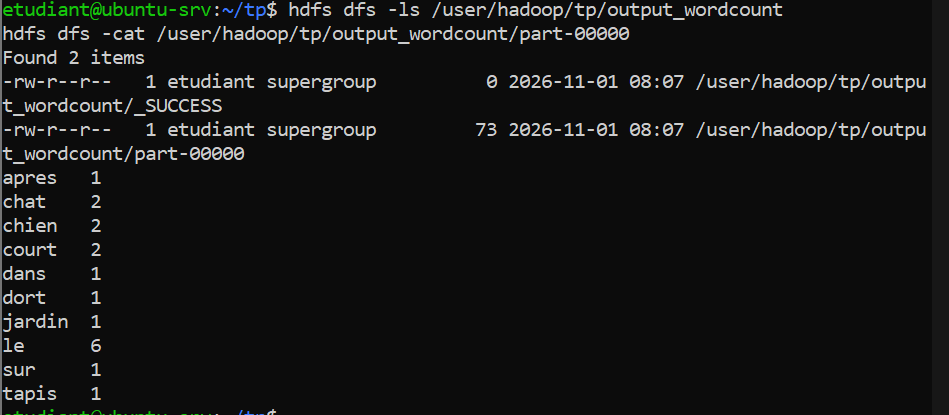

Test sur un vrai texte : les 20 mots les plus fréquents du livre (surtout des mots outils : de, il, la, et, le).

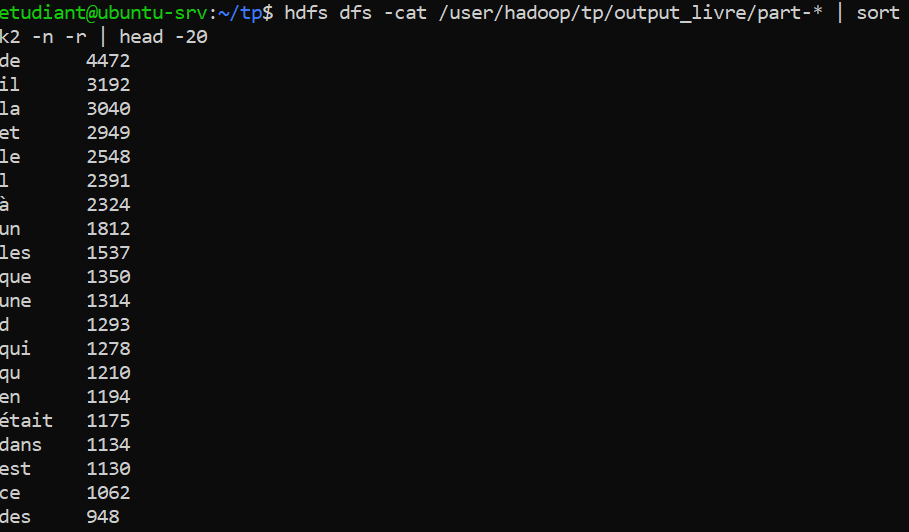

**Exercice 3 — Chiffre d'affaires par ville** : résultat conforme à l'attendu.

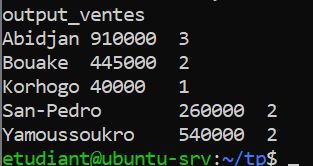

**Exercice 4 — Température maximale par année** : 2024 : 35.0 et 2025 : 36.1.

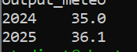

**Exercice 5 — Moyenne par matière** : job non exécuté, le TP ne fournit pas de fichier `notes.csv`.

**Exercice 6 — Index inversé** : job non exécuté sur Hadoop ; résultat attendu avec les fichiers d'exemple :

**Fichiers d'entrée (exemple)**

```text
doc1.txt : le chat dort sur le tapis
doc2.txt : le chien court dans le jardin
doc3.txt : le chat court dans la maison
```

**Résultat attendu**

```text
chat      doc1.txt,doc3.txt
chien     doc2.txt
court     doc2.txt,doc3.txt
dans      doc2.txt,doc3.txt
dort      doc1.txt
jardin    doc2.txt
la        doc3.txt
le        doc1.txt,doc2.txt,doc3.txt
maison    doc3.txt
sur       doc1.txt
tapis     doc1.txt
```

---

## 2. Code source commenté (exercices 2 à 6)

### Exercice 2 — WordCount

Le **mapper** découpe le texte en mots et émet (mot, 1). Hadoop trie par mot, puis le **reducer** additionne les 1 de chaque mot.

**`mapper.py`**

```python
#!/usr/bin/env python3
import sys, re

for ligne in sys.stdin:                    # lit le fichier ligne par ligne (stdin)
    ligne = ligne.strip().lower()          # supprime les espaces, met en minuscules
    mots = re.findall(r"[a-zàâäéèêëîïôöùûüç]+", ligne)   # extrait les mots
    for mot in mots:
        print(f"{mot}\t1")                 # émet la paire : mot <TAB> 1
```

**`reducer.py`**

```python
#!/usr/bin/env python3
import sys

mot_courant, total = None, 0               # mot en cours et son compteur

for ligne in sys.stdin:                    # lignes déjà triées par mot
    mot, valeur = ligne.rstrip("\n").split("\t", 1)
    try:
        valeur = int(valeur)
    except ValueError:
        continue                           # ignore une ligne mal formée
    if mot == mot_courant:
        total += valeur                    # même mot : on additionne
    else:
        if mot_courant is not None:
            print(f"{mot_courant}\t{total}")   # mot terminé : on l'écrit
        mot_courant, total = mot, valeur       # nouveau mot
if mot_courant is not None:
    print(f"{mot_courant}\t{total}")           # dernier mot
```

**Commande Hadoop Streaming**

```bash
hadoop jar $HADOOP_HOME/share/hadoop/tools/lib/hadoop-streaming-3.3.6.jar \
  -files mapper.py,reducer.py \
  -mapper "python3 mapper.py" -reducer "python3 reducer.py" \
  -input /user/hadoop/tp/input -output /user/hadoop/tp/output_wordcount
```

### Exercice 3 — Chiffre d'affaires par ville

Le **mapper** calcule quantité × prix et émet (ville, montant). Le **reducer** cumule le total et compte les ventes par ville.

**`mapper_ventes.py`**

```python
#!/usr/bin/env python3
import sys

for ligne in sys.stdin:
    ligne = ligne.strip()
    if not ligne or ligne.startswith("date"):   # ignore ligne vide et en-tête
        continue
    champs = ligne.split(",")
    if len(champs) != 5:                        # ignore une ligne incomplète
        continue
    _, ville, _, quantite, prix = champs
    try:
        montant = int(quantite) * float(prix)   # montant = quantité x prix
    except ValueError:
        continue
    print(f"{ville}\t{montant}")                # clé = ville, valeur = montant
```

**`reducer_ventes.py`**

```python
#!/usr/bin/env python3
import sys

ville_courante, total, nb = None, 0.0, 0        # ville en cours, total, nb de ventes

def emettre(ville, total, nb):
    print(f"{ville}\t{total:.0f}\t{nb}")         # ville, chiffre d'affaires, nb ventes

for ligne in sys.stdin:                         # lignes triées par ville
    ville, montant = ligne.rstrip("\n").split("\t")
    montant = float(montant)
    if ville == ville_courante:
        total += montant                        # même ville : on cumule
        nb += 1
    else:
        if ville_courante is not None:
            emettre(ville_courante, total, nb)  # ville terminée
        ville_courante, total, nb = ville, montant, 1
if ville_courante is not None:
    emettre(ville_courante, total, nb)          # dernière ville
```

### Exercice 4 — Température maximale par année

Le **mapper** émet (année, température). Le **reducer** garde le maximum au lieu de faire une somme.

**`mapper_meteo.py`**

```python
#!/usr/bin/env python3
import sys

for ligne in sys.stdin:
    champs = ligne.strip().split(",")
    if len(champs) != 3:                   # ignore une ligne mal formée
        continue
    annee, _, temp = champs
    try:
        float(temp)                        # vérifie que c'est un nombre
    except ValueError:
        continue
    print(f"{annee}\t{temp}")              # clé = année, valeur = température
```

**`reducer_meteo.py`**

```python
#!/usr/bin/env python3
import sys

cur, mx = None, None                       # année en cours et son maximum

for ligne in sys.stdin:                    # lignes triées par année
    annee, temp = ligne.rstrip("\n").split("\t")
    temp = float(temp)
    if annee == cur:
        mx = max(mx, temp)                 # on garde le maximum (pas de somme)
    else:
        if cur is not None:
            print(f"{cur}\t{mx}")          # année terminée
        cur, mx = annee, temp
if cur is not None:
    print(f"{cur}\t{mx}")                  # dernière année
```

### Exercice 5 — Moyenne des notes par matière

Le **mapper** émet (matière, note, 1). Le **combiner** additionne sommes et effectifs sans diviser ; le **reducer** divise à la fin.

**`mapper_notes.py`**

```python
#!/usr/bin/env python3
import sys

for ligne in sys.stdin:
    ligne = ligne.strip()
    if not ligne or ligne.startswith("etudiant"):   # ignore l'en-tête
        continue
    champs = ligne.split(",")
    if len(champs) != 3:
        continue
    _, matiere, note = champs
    try:
        float(note)
    except ValueError:
        continue
    print(f"{matiere}\t{note}\t1")         # matière, note, effectif 1
```

**`combiner_notes.py`**

```python
#!/usr/bin/env python3
import sys

cur, s, c = None, 0.0, 0                   # matière, somme des notes, effectif

for ligne in sys.stdin:                    # lignes triées par matière
    m, n, k = ligne.rstrip("\n").split("\t")
    n, k = float(n), int(k)
    if m == cur:
        s += n                             # additionne les notes
        c += k                             # additionne les effectifs
    else:
        if cur is not None:
            print(f"{cur}\t{s}\t{c}")      # sortie partielle, sans diviser
        cur, s, c = m, n, k
if cur is not None:
    print(f"{cur}\t{s}\t{c}")
```

**`reducer_notes.py`**

```python
#!/usr/bin/env python3
import sys

cur, s, c = None, 0.0, 0                   # identique au combiner...

for ligne in sys.stdin:
    m, n, k = ligne.rstrip("\n").split("\t")
    n, k = float(n), int(k)
    if m == cur:
        s += n
        c += k
    else:
        if cur is not None:
            print(f"{cur}\t{s / c:.2f}")   # ... mais on divise ici : moyenne
        cur, s, c = m, n, k
if cur is not None:
    print(f"{cur}\t{s / c:.2f}")
```

### Exercice 6 — Index inversé

Le **mapper** émet (mot, nom du fichier). Le **reducer** regroupe les fichiers distincts qui contiennent chaque mot.

**`mapper_index.py`**

```python
#!/usr/bin/env python3
import sys, os, re

# nom du fichier en cours de lecture (variable d'environnement de Hadoop)
chemin = os.environ.get("mapreduce_map_input_file") or os.environ.get("map_input_file", "inconnu")
fichier = os.path.basename(chemin)

for ligne in sys.stdin:
    for mot in re.findall(r"[a-zàâäéèêëîïôöùûüç]+", ligne.lower()):
        print(f"{mot}\t{fichier}")         # clé = mot, valeur = nom du fichier
```

**`reducer_index.py`**

```python
#!/usr/bin/env python3
import sys

cur, fichiers = None, set()                # mot en cours, ensemble de fichiers (sans doublon)

for ligne in sys.stdin:                    # lignes triées par mot
    mot, f = ligne.rstrip("\n").split("\t")
    if mot == cur:
        fichiers.add(f)                    # même mot : on ajoute le fichier
    else:
        if cur is not None:
            print(f"{cur}\t{','.join(sorted(fichiers))}")   # mot terminé
        cur, fichiers = mot, {f}
if cur is not None:
    print(f"{cur}\t{','.join(sorted(fichiers))}")
```

---

## 3. Réponses aux questions

### 3.1 Questions des encadrés

*Exercice 1 — HDFS*

1. **Combien de blocs `poeme.txt` occupe-t-il ? Pourquoi ?** 1 bloc : le fichier (85 octets) est bien plus petit que la taille d'un bloc (128 Mo). Il n'occupe que sa taille réelle.
2. **Retrouver le fichier dans l'interface du NameNode.** Fait : `http://localhost:9870`, Utilities, Browse the file system, `/user/hadoop/tp/input/poeme.txt` (voir capture en 1.4).
3. **Nombre de blocs d'un fichier de 1 Go, et espace avec réplication 3 ?** 1024 Mo / 128 Mo = 8 blocs. Avec réplication 3 : 24 blocs, soit 3 Go d'espace disque.

*Exercice 5 — Moyenne par matière*

- **Peut-on utiliser le reducer de moyenne comme combiner ? Justifier.** Non : la moyenne des moyennes n'est pas la moyenne globale si les effectifs diffèrent. Le mapper émet `matiere<TAB>note<TAB>1` ; combiner et reducer additionnent sommes et effectifs, et on divise seulement à la fin.

### 3.2 Questions de synthèse

1. **Définition d'un cluster et trois avantages.** Ensemble d'ordinateurs (nœuds) reliés en réseau et coordonnés par un logiciel, fonctionnant comme un seul système. Avantages : gros volumes, calcul parallèle, haute disponibilité.
2. **Scalabilité verticale et horizontale.** Verticale : machine plus puissante (limitée, chère). Horizontale : ajout de machines. Hadoop exploite l'horizontale.
3. **Rôle du NameNode et point sensible.** Il gère l'arborescence HDFS et la localisation des blocs (sans stocker de données). S'il tombe, HDFS est inaccessible.
4. **Le Secondary NameNode est-il une copie de secours ?** Non. Il fusionne périodiquement `edits` et `fsimage` (checkpoint) ; il ne remplace pas le NameNode en cas de panne.
5. **Localité des données.** Envoyer le programme (petit) vers les données (volumineuses). Cela réduit le trafic réseau et accélère le traitement.
6. **Phases d'un job MapReduce.** Input/Split, Map, Combine (facultatif), Partition, Shuffle & Sort, Reduce, Output. Le développeur écrit Map, Combine et Reduce.
7. **Pourquoi les lignes d'une même clé sont-elles consécutives ?** Parce que Hadoop trie les paires par clé (Shuffle & Sort) avant de les donner au reducer.
8. **Quand utiliser un combiner ?** Quand l'opération est associative et commutative (somme, max). Contre-exemple : la moyenne (il faut transporter somme et effectif).
9. **Panne d'un nœud pendant une tâche Map.** L'ApplicationMaster relance la tâche sur un autre nœud, grâce aux répliques HDFS du bloc. Le job continue.
10. **Deux limites de MapReduce et un outil.** Lent pour les traitements itératifs (écritures disque) et latence élevée (pas de temps réel). Spark répond à ces limites.
